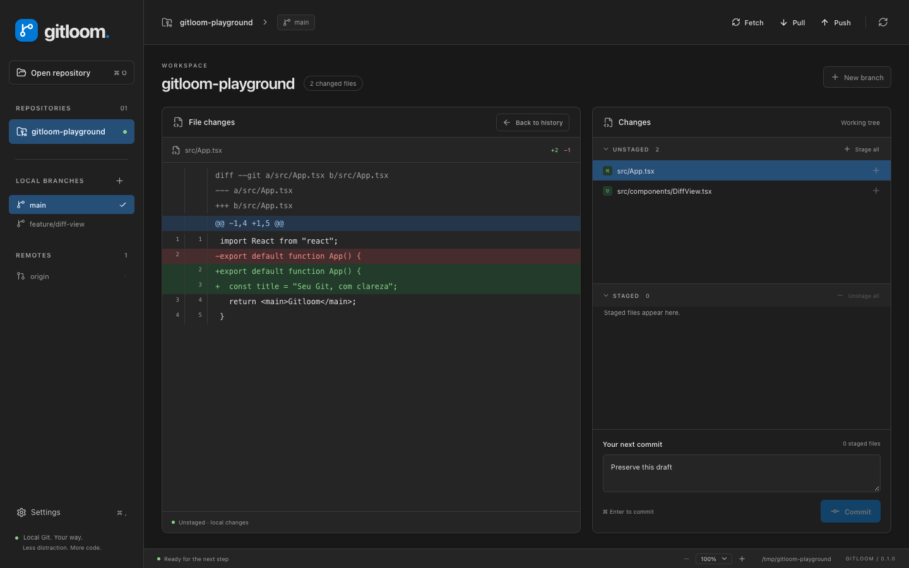

# Gitloom

Um cliente Git desktop para macOS, feito para acompanhar o histórico, revisar diffs e preparar commits em uma interface focada.

**V1 · versão 0.4.0** — React, TypeScript e Tauri 2. Usa o Git instalado na máquina, sem exigir conta ou serviço próprio do Gitloom.



_Prévia com um repositório fictício._

## Recursos

- Histórico de todas as branches, coluna própria para branches/tags, grafo com foto ou iniciais do committer e busca por mensagem, autor, hash ou referência.
- Diff unificado no painel esquerdo ao selecionar um arquivo; voltar ao histórico preserva a busca e a posição da lista.
- Working tree e stage com rolagem independente, stage/unstage por arquivo ou em lote e seleção automática do arquivo movido.
- Commits com rascunhos salvos por repositório e restaurados após reiniciar; o rascunho é limpo após um commit bem-sucedido.
- Stage/unstage por hunk em arquivos de texto rastreados e modificados, com rejeição de prévias desatualizadas.
- Orientação para divergência, upstream ausente, autenticação e operações Git em andamento, preservando os diagnósticos originais.
- Criação, troca e exclusão de branches locais integradas; branches remotas com checkout rastreado; fetch, pull com fast-forward e push.
- Worktrees: criar com nova branch ou HEAD destacado, abrir e remover sem forçar alterações ou bloqueios.
- Stashes: salvar incluindo arquivos novos, aplicar, aplicar e remover ou excluir, com confirmação nas remoções.
- Tags locais: criar em um commit/referência, abrir com HEAD destacado ou excluir.
- Oito repositórios recentes, atualização ao retornar à janela e sidebar redimensionável com largura salva.
- Seis temas, interface em inglês ou português do Brasil e tamanho do texto configurável.

## Requisitos

| Ferramenta          | Requisito                           |
| ------------------- | ----------------------------------- |
| Sistema             | macOS; plataforma validada nesta V1 |
| Node.js             | 22.12+ ou 24+ e npm                 |
| Git                 | Instalado e disponível no `PATH`    |
| Rust                | Canal stable atualizado, com Cargo  |
| Apple               | Xcode Command Line Tools            |
| Testes de interface | Google Chrome instalado             |

A autenticação dos remotos usa sua configuração existente do Git, incluindo SSH agent e credential helpers. Configure o acesso aos seus repositórios pelo Git antes de sincronizar no aplicativo.

## Começar

O repositório é privado: o clone exige acesso à conta ou uma chave SSH autorizada.

```sh
git clone git@github.com:pedrohperalta/gitloom.git
cd gitloom
npm ci
npm run tauri -- dev
```

Na primeira execução, o Cargo baixa e compila as dependências Rust. Abra um repositório Git existente pelo botão **Open repository** ou por **⌘ O**.

Para desenvolver somente a interface no navegador:

```sh
npm run dev
```

O navegador não executa operações Git reais; o acesso aos arquivos e comandos Git funciona no aplicativo Tauri. Os testes de interface simulam a comunicação com o backend.

### Gerar o aplicativo

```sh
npm run tauri -- build --bundles app
```

O bundle fica em `src-tauri/target/release/bundle/macos/Gitloom.app`. Esta configuração gera um build local; assinatura e notarização para distribuição não fazem parte da V1.

Para gerar o instalador macOS com a janela de instalação personalizada:

```sh
npm run build:dmg
```

O comando compila o `.app` com o Tauri e cria o instalador com `dmgbuild`, sem depender da automação do Finder (que pode falhar com timeout no macOS). Requer Python 3.10+; na primeira execução instala as dependências fixadas em `scripts/dmg-requirements.txt` num ambiente isolado em `.toolchain/dmgbuild/`.

O `.dmg` fica em `src-tauri/target/release/bundle/dmg/`. A janela usa um fundo próprio com instruções para arrastar o Gitloom para Applications. O layout é definido em `bundle.macOS.dmg` no `src-tauri/tauri.conf.json`; para recriar o fundo no macOS, execute `swift scripts/generate-dmg-background.swift`. O PNG gerado já está incluído no repositório.

O script `scripts/tauri.mjs` usa o Rust do `PATH`. Se existir uma instalação isolada em `.toolchain/`, ele a detecta e configura somente o processo filho. Essa pasta é local e não faz parte do repositório.

## Uso

1. Abra um repositório local e consulte o histórico ou as alterações atuais.
   Use o botão no topo da barra lateral, ao lado da marca para recolher ou expandir a barra lateral. No modo recolhido, os atalhos de repositórios, abertura e configurações continuam disponíveis.
   Arraste o divisor entre History e Changes para ajustar a proporção dos painéis, inclusive ao visualizar um diff. Com o divisor em foco, use as setas para ajustar (Shift para passos maiores), Home/End para os limites e Enter ou clique duplo para restaurar. O estado da barra lateral e a proporção escolhida são salvos entre sessões.
2. Selecione um arquivo para revisar o diff no painel esquerdo.
3. Use **+** para preparar o arquivo ou **−** para retirá-lo do stage. Em arquivos de texto modificados, use **Preparar hunk / Stage hunk** ou **Retirar hunk do stage / Unstage hunk** no cabeçalho do trecho para mover apenas aquela alteração.
4. Escreva uma mensagem e faça o commit dos arquivos preparados.
5. Sincronize com **Fetch**, **Pull** ou **Push**, quando necessário.

O primeiro push usa `origin`, ou o único remoto disponível, e configura o upstream. Se houver ambiguidade entre remotos, configure o destino pelo Git.

Fotos dos committers são carregadas sob demanda do GitHub, usando o ID de emails noreply ou o commit no remoto `origin` do GitHub. A consulta de commits usa a API pública sem login: repositórios privados, commits ainda não enviados, limites da API e falhas de rede podem resultar em iniciais. As consultas são compartilhadas por committer durante a sessão.

### Atalhos

| Atalho    | Ação                                             |
| --------- | ------------------------------------------------ |
| ⌘ O       | Abrir repositório                                |
| ⌘ R       | Atualizar repositório                            |
| ⌘ Enter   | Fazer commit, com mensagem e arquivos preparados |
| ⌘ ,       | Abrir configurações                              |
| ⌘ + / ⌘ − | Aumentar ou diminuir o texto da interface        |
| ⌘ 0       | Restaurar o texto para 100%                      |

### Aparência e idioma

Abra **Settings / Configurações** na sidebar. As alterações são aplicadas imediatamente e salvas localmente.

- **Temas:** Dark (padrão), Light, Darcula, Nord, Sage e Follow system. O tema do sistema acompanha mudanças de claro/escuro.
- **Idiomas:** English (padrão) e Português (Brasil). Conteúdo dos arquivos, mensagens de commits e saídas originais do Git mantêm seu idioma.
- **Texto:** 100%, 110%, 125%, 140% ou 150%, também ajustável pela barra inferior. A altura das linhas acompanha a escala.
- **Diff:** fonte independente, de 10 a 24 px.
- **Histórico:** arraste a divisória do cabeçalho Branch / Tag para ajustar a coluna. Com a divisória em foco, use as setas; Home/End selecionam os limites e Enter ou clique duplo restaura a largura padrão. A largura é salva; referências longas quebram linha e o grafo acompanha a altura resultante.
- **Navegação:** clique no título de uma seção da sidebar para recolher ou expandir seu conteúdo. O estado é salvo, inclusive para os grupos de remotos.
- **Diff:** um segundo clique no arquivo selecionado volta ao histórico, mantendo a busca e o commit selecionado.
- **Sidebar:** arraste a borda direita para ajustar a largura. Clique duplo restaura a largura automática. Com a divisória em foco, use as setas; Shift acelera o ajuste, Home/End selecionam os limites e Enter restaura o padrão.

## Arquitetura

```text
src/
  App.tsx              Workspace, seleção, navegação e operações
  graph.ts             Layout do grafo e interpretação do diff
  types.ts             Contratos entre frontend e backend
  preferences.ts       Persistência de preferências e tema nativo
  locales/             Catálogos de inglês e português do Brasil
  themes.css           Tokens semânticos dos temas
src-tauri/
  src/git.rs           Execução de Git, parsing e testes com Git real
  src/lib.rs           Comandos Tauri assíncronos e serialização de operações
  capabilities/        Permissões concedidas à janela
scripts/tauri.mjs       Inicialização da CLI Tauri
e2e/                  Testes de interface com backend simulado
```

O frontend chama quatro comandos Tauri: `repository`, `changes`, `diff` e `operate`. O backend executa o Git diretamente, sem interpolação de shell, usa pathspecs literais para arquivos e serializa as operações. Hooks e assinatura de commits seguem a configuração do Git.

Repositórios recentes, preferências e rascunhos de commit por caminho canônico de repositório ficam no armazenamento local do aplicativo. Rascunhos são salvos ao editar, restaurados ao abrir o repositório e removidos após commit bem-sucedido; falhas de armazenamento exibem um aviso. O identificador interno `dev.local.ramo` e a chave `ramo.recents` foram mantidos para preservar os dados das versões iniciais; o nome do produto, do pacote e do executável é Gitloom.

## Verificação

```sh
npm run build
npm test
npm run test:e2e
cargo test --locked --manifest-path src-tauri/Cargo.toml
```

| Verificação | Cobertura                                                   |
| ----------- | ----------------------------------------------------------- |
| Build       | TypeScript e bundle de produção do frontend                 |
| Vitest      | Grafo, diff, traduções e validação das preferências         |
| Playwright  | Workspace, commits, stage, temas, idiomas, escala e sidebar |
| Cargo       | Operações Git reais em repositórios temporários             |

### Revisão de UI antes de uma release

Mudanças de interface precisam de evidência por comportamento, além do resultado do build. Execute `npm run test:ui` durante o ajuste e a suíte completa `npm run test:e2e` antes da publicação.

- Verifique a coluna Branch / Tag com nomes longos: arrastar, teclado, restaurar, persistir após reload, quebra de linha sem truncamento e continuidade do grafo.
- Recolha e expanda cada seção e cada remoto por mouse e teclado. Confirme que o estado persiste e que os botões de ação continuam acessíveis.
- Confira contadores junto aos títulos e alinhamento à esquerda de nomes e subtítulos das worktrees.
- Abra e feche o diff clicando no mesmo arquivo, em alterações locais, stage e commits históricos. Preserve busca e seleção do commit.
- Exercite cada exclusão: abrir confirmação não executa a operação; Cancelar e Escape preservam o item; só confirmar executa a ação. O foco inicial deve ficar em Cancelar.
- Inspecione as capturas `test-results/ui-review-*.png`, geradas em inglês e português, nas escalas 100% e 150%, com janelas de 1080 e 1440 px. Testes de geometria verificam os alinhamentos; as capturas exigem revisão visual, não são snapshots aprovados automaticamente.
- Antes de publicar, abra o aplicativo do pacote gerado no macOS e repita os fluxos alterados. A validação no navegador com backend simulado não substitui essa verificação do pacote nativo.

O Playwright inicia o Vite automaticamente e usa o Chrome instalado, sem caminhos específicos de uma máquina. Seus testes não substituem os testes do backend com Git real.

Se estiver usando a instalação Rust isolada:

```sh
RUSTUP_HOME="$PWD/.toolchain/rustup" \
CARGO_HOME="$PWD/.toolchain/cargo" \
.toolchain/cargo/bin/cargo test --locked --manifest-path src-tauri/Cargo.toml
```

Formatação:

```sh
npm run format
```

## Limitações da V1

- Stage por hunk limitado a texto UTF-8 em arquivos rastreados e modificados, sem renomeação, conflito ou mudança de modo. Arquivos novos, removidos, binários e especiais usam stage por arquivo; seleção de linhas ainda não está disponível.
- Prévia desatualizada é rejeitada ao mover hunks; revise o diff atualizado antes de tentar novamente.
- Sem descarte de alterações, reset destrutivo, force push ou editor de conflitos. Resolva conflitos externamente e prepare os arquivos antes do commit. O app identifica merge, rebase, cherry-pick, revert e aplicação de patches (`git am`) em andamento. Merge pode ser concluído com commit no app; as demais operações devem ser continuadas ou abortadas no terminal, seguindo a orientação exibida. Troca/criação de branches e pull ficam bloqueados durante essas operações.
- Pull usa `--ff-only`; históricos divergentes precisam ser reconciliados pelo Git.
- Sem login OAuth ou terminal interativo para senha. A autenticação depende da configuração existente do Git.
- Histórico inicial de 400 commits, com paginação até 5.000. A busca considera apenas os commits carregados.
- Diffs de merges comparam o commit com o primeiro pai.
- Arquivos novos maiores que 1 MB, binários e links simbólicos têm prévia limitada. Saídas de comandos têm limite de 12 MB e tempo de execução de 120 segundos.
- Repositórios bare e nomes de arquivo que não sejam UTF-8 não são suportados.
- Linux e Windows ainda não foram validados.

## Desenvolvimento

Use mensagens de commit no formato `tipo: descrição`, por exemplo `fix: preserve file selection after staging`. Separe mudanças por responsabilidade e execute as verificações relevantes antes de enviar.

Para adicionar textos, atualize os dois catálogos em `src/locales/`. Para ajustar cores, use os tokens em `src/themes.css`. Operações Git devem ficar no backend, com argumentos explícitos e testes em repositórios temporários.

Ao reportar um problema, inclua a versão, o macOS, os passos para reproduzir e o resultado esperado. Use dados fictícios em screenshots e não inclua tokens, credenciais ou conteúdo privado de repositórios.

O Gitloom é uma implementação própria. Não depende do REA e não incorpora código extraído do GitKraken.
